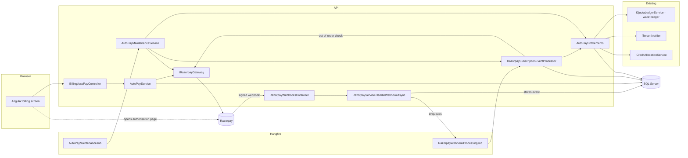
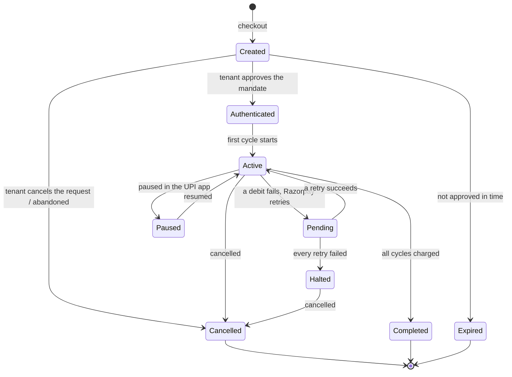

# Razorpay UPI AutoPay - Architecture

How recurring plan billing through Razorpay UPI AutoPay is built. For why it was built this way, see
[razorpay-autopay-analysis.md](razorpay-autopay-analysis.md); where this document and the analysis differ, this one
describes what exists.

Code lives in two repositories: this one (API) and `AI-Sales-Automation-System-angular` (the billing screen), each
on a `feature/razorpay-autopay` branch.

## 1. The idea in one paragraph

A tenant picks a paid plan. The API creates a Razorpay subscription for it and returns Razorpay's authorisation
page. The tenant approves a UPI AutoPay mandate there, in their UPI app. From then on **Razorpay** debits the tenant
every month by itself. Each debit reaches the API as a signed webhook; the API records the payment, extends the
plan's paid-through date and adds the plan's credits to the existing wallet. Nothing in this application ever
initiates a debit, and nothing a browser says is ever treated as proof of payment.

## 2. Components

| Component | Layer | Responsibility |
|---|---|---|
| `IRazorpayGateway` / `RazorpayGateway` | Application / Infrastructure | Razorpay's REST API. Plans, subscriptions, invoices (and, from before, orders, payments, refunds). Never throws on a gateway error; returns `RazorpayResult<T>`. |
| `AutoPayService` | Application | Checkout, current mandate, refresh from Razorpay, cancel, invoices. |
| `RazorpayService.HandleWebhookAsync` | Application | Verifies the signature, de-duplicates, stores the event. Subscription events are queued; the test page's order events are still applied inline. |
| `RazorpaySubscriptionEventProcessor` | Application | Applies one stored event to its mandate, once, in any order. |
| `AutoPayEntitlements` | Application | What a payment or a state change means for the tenant: payment row, plan and period, credits, notices. |
| `AutoPayMaintenanceService` | Application | Webhook retries, daily reconciliation, ending lapsed plans. |
| `RazorpayMandateState` | Application | The one place Razorpay's picture of a subscription is copied onto a mandate row. |
| `RazorpayWebhookProcessingJob`, `AutoPayMaintenanceJob` | Infrastructure | Hangfire entry points. |
| `BillingAutoPayController` | API | Thin; tenant Admin only; tenant always from the token. |

Payment processing (getting an event safely applied once) and subscription business logic (what the tenant is owed)
are separated by the `IAutoPayEntitlements` interface.

## 3. Data model

New tables:

| Table | Scope | Purpose |
|---|---|---|
| `RazorpayPlans` | Global | Maps one internal plan at one exact charge to an immutable Razorpay plan. Unique on `(PlanId, Mode, Currency, AmountMinor, Period, Interval)` and on `RazorpayPlanId`. |
| `RazorpaySubscriptions` | Tenant | One row per mandate attempt: Razorpay's subscription id and status, agreed amount, billing cycle, authorisation link. Never deleted. Unique on `RazorpaySubscriptionId`; at most one row per tenant in `Created`. |

Changed tables:

| Table | Added |
|---|---|
| `Subscriptions` | `RazorpaySubscriptionRowId` (the mandate paying for the plan), `CancelAtPeriodEnd`. |
| `Payments` | `ProviderPaymentId`, `ProviderInvoiceId`, `ProviderSubscriptionId`, `PaymentMethod`, `Status` (`Succeeded`/`Failed`), `FailureReason`. Unique on `(Provider, ProviderPaymentId)` where the id is not null. |
| `RazorpayWebhookEvents` | `SubscriptionId`, `ProcessingStatus` (`Received`/`Completed`/`Failed`/`Ignored`), `ProcessedAtUtc`, `RetryCount`, `ErrorMessage`, `EventCreatedAtUtc`. The payload is stored whole. |

Reused unchanged: `Plans`, `PlanPrices`, `QuotaWallets`, `QuotaGrants`, `QuotaLedgerEntries`, `TenantNotifications`.
There is still one wallet and one ledger.

No UPI id, PIN, bank detail or card data is stored anywhere.

Migration: `20261116142726_AddRazorpayAutoPay`.

## 4. Subscription lifecycle

These are Razorpay's states, mirrored on `RazorpaySubscriptions.Status`. What the screen shows is derived from them:

| Shown | From |
|---|---|
| Pending authorization | `Created` |
| Payment pending | `Authenticated` with no payment counted yet |
| Active | `Active`, or `Authenticated` with a payment counted |
| Past due | `Pending` |
| Halted | `Halted` |
| Paused | `Paused` |
| Cancellation scheduled | `Active`/`Authenticated` with cancel-at-cycle-end set |
| Cancelled | `Cancelled` |
| Expired | `Expired` or `Completed` |

The tenant's own `Subscriptions` row (one per tenant, "what access do they have now") changes only when a payment is
confirmed or the plan lapses:

| Event | Effect on the tenant's plan |
|---|---|
| Checkout, authorisation, refresh | None. |
| Confirmed charge | On the plan, `Active`, paid through to the cycle's end, linked to the mandate. Credits added. |
| Debit fails, Razorpay retrying | None. The plan keeps working through the grace days. Tenant notified once per cycle. |
| Every retry failed (`Halted`) | `PastDue`. Tenant notified. |
| Mandate running again | Back to `Active`. |
| Mandate cancelled, completed or expired | Plan kept; marked not renewing. Tenant notified. |
| Paid period + 4 grace days over, mandate not paying | Moved to the Trial plan. Wallet credits kept. Tenant notified. |

## 5. Checkout

1. Tenant Admin posts the plan id. Nothing else is accepted.
2. AutoPay must be switched on and Razorpay keys saved.
3. The amount is computed on the server: the price set for the tenant's country plus tax, in paise.
4. Refused before anything is created at Razorpay when the plan is free, is not billed in rupees, or exceeds the UPI
   limit (`Billing:AutoPay:MaxRecurringAmountInr`, default 15,000).
5. Any open mandate of the tenant is checked against Razorpay first. A running one blocks the checkout. A waiting one
   for the same plan and amount is returned as it is; one for a different amount is cancelled at Razorpay first.
6. The Razorpay plan for this exact charge is found or created, then the subscription is created with
   `total_count` 120 and an authorisation expiry of 48 hours.
7. The mandate row is saved as `Created` and the authorisation URL returned.

## 6. Webhooks

See [razorpay-autopay-webhooks.md](razorpay-autopay-webhooks.md).

## 7. Wallet integration

The existing wallet is not redesigned. A confirmed charge calls the existing
`IQuotaLedgerService.GrantPlanCreditsAsync` with:

- operation key `rzp-charge:{razorpay payment id}`,
- origin `PlanAllocation`,
- the `Payments` row id as the grant's payment reference.

Credits granted this way never expire and carry over, exactly like plan credits granted before. The calendar-month
job (`CreditAllocationService.AllocateMonthlyAsync`) skips any plan a mandate pays for, so a month is never granted
twice.

### Exactly-once

| Layer | Guard |
|---|---|
| Webhook delivery | Unique index on `RazorpayWebhookEvents.EventId`. A redelivery is not stored again. |
| Event processing | A `Completed` or `Ignored` event is never applied again. |
| Payment record | Unique index on `Payments (Provider, ProviderPaymentId)`. The same payment arriving through two events, the reconciliation pass, or two workers at once is one row. |
| Credits | The ledger grants an operation key once; the wallet row's concurrency token serialises racing grants. |

The payment row and the plan change are one save. The credit grant follows and is safe to repeat, so a failure at
any point is recovered by running the whole step again.

## 8. Payment failure handling

- Razorpay retries a failed debit on each of the next three days, then halts the subscription.
- A failed attempt is recorded as a `Failed` payment row with Razorpay's reason. It grants nothing and is left out of
  the platform payment list and the revenue report.
- The plan keeps working for `AutoPayOptions.GraceDays` (4) after the paid period ends, including AI replies.
- After that, with the mandate not paying, the hourly pass moves the tenant to the Trial plan.
- A halted mandate is not restarted: the tenant cancels it and subscribes again.

## 9. Background jobs

| Job id | Schedule (UTC) | Does |
|---|---|---|
| (enqueued per event) | on arrival | Applies one stored subscription webhook. |
| `razorpay-webhook-retry` | every 5 minutes | Applies events no job picked up after 2 minutes, and failed events that are due another try (wait doubles from 5 minutes to 6 hours; 10 attempts). |
| `autopay-reconciliation` | daily 01:45 | Compares every live mandate with Razorpay, repairs status, recovers missed payments from invoices, cancels authorisations abandoned for 72 hours. |
| `autopay-lapsed-plans` | hourly at :25 | Ends plans whose mandate has stopped paying and whose paid period plus grace is over. |

None of them starts a debit.

## 10. Plan upgrade and downgrade

Razorpay does not allow a UPI subscription to be updated, so a plan or price change needs a new mandate. Today there
is one paid plan, so the only transitions are:

- Trial to paid: subscribe (new mandate).
- Paid to Trial: cancel automatic payment; the plan runs to the end of the paid period, then lapses to Trial.

The simulated "choose plan" endpoint refuses to switch a plan while its mandate is still charging.

For a future second paid plan the intended flow is: start the new mandate, cancel the old one at cycle end once the
new one is authorised, and switch plan when the new mandate's first charge is confirmed. This is **not built**. The
database already allows an old and a new mandate to be open together; `AutoPayService.CheckoutAsync` currently
refuses a second running mandate and would need changing.

## 11. Security

- Razorpay key secret and webhook secret are stored encrypted in the settings table and never sent to a browser.
- Webhooks are authenticated by HMAC-SHA256 over the raw body, compared in constant time; the endpoint is anonymous,
  rate limited and capped at 256 KB.
- Every tenant endpoint requires the `Admin` role and takes the tenant from the token. A mandate is always looked up
  by id **and** tenant.
- Amounts are computed on the server and checked again when a charge arrives: a payment that differs from the
  mandate's amount or currency is not credited.
- Logs carry Razorpay ids and tenant ids, never secrets or payer details.

## 12. Known limits

- Refunds of Razorpay payments are refused in the app; the refund gateway is still simulated.
- Credit-pack purchase is still simulated.
- Pause and resume cannot be started from the app; a pause made in the UPI app is mirrored.
- Standalone `payment.authorized` and `payment.captured` events are not used for subscriptions; `subscription.charged`
  is the signal.
- There is no operator alert when a webhook is given up on, only a critical log entry.
